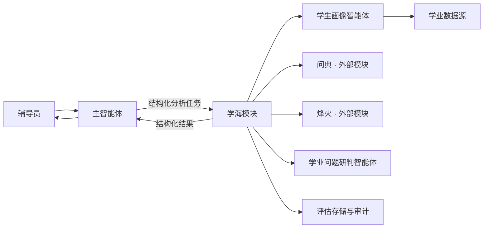
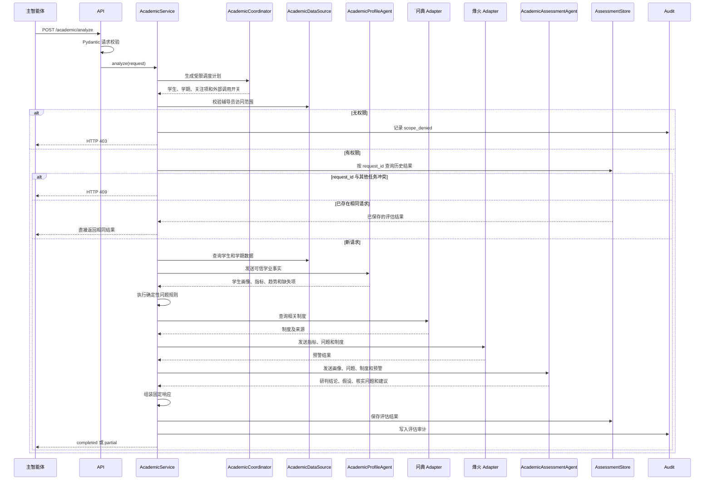

# 学海模块调度架构说明

> 版本：第一阶段 MVP（2026-11-18）
> 适用对象：后端开发、主智能体开发、问典/烽火模块开发、测试人员
> 当前范围：单个学生、单个学期的学业风险分析

## 1. 一句话说明

学海由一个主智能体调度两个内部子智能体：学生画像智能体负责生成结构化画像，学业问题研判智能体负责基于画像和外部模块结果形成研判。

主智能体把“分析某位学生本学期成绩下降和缺勤情况”转换成结构化任务后，学海按照固定顺序完成：

```text
校验请求 → 生成调度计划 → 校验权限 → 读取学业数据
→ 画像智能体生成画像 → 识别确定性问题
→ 主智能体调用外部问典和烽火 → 研判智能体形成结论与建议
→ 保存结果 → 写入审计 → 返回调用方
```

整个流程目前是一次 HTTP 请求内完成的同步串行流程，没有使用 Celery、Redis 或 LangGraph。

## 2. 系统位置



各系统的职责边界：

| 组件 | 负责 | 不负责 |
|---|---|---|
| 主智能体 | 理解辅导员问题、生成结构化任务、整合最终回复 | 不直接计算学业指标 |
| 学海主智能体 | 校验请求、生成计划、调度子智能体和外部模块、组装结果 | 不直接计算指标，不代替辅导员决策 |
| 学生画像智能体 | 基于可信数据生成指标、趋势、风险课程和完整性说明 | 不查询制度，不判断预警，不生成处置结论 |
| 学业问题研判智能体 | 综合画像、确定性问题、制度和预警形成研判与建议 | 不修改画像、制度或烽火等级 |
| 问典 | 提供制度条款、版本、生效时间和来源 | 不决定最终预警等级 |
| 烽火 | 根据事实、问题和制度结果进行预警检测 | 不生成完整学业报告 |

问典和烽火属于学海外部模块，学海只通过 Adapter 调用。

## 3. 对外接口

### 健康检查

```http
GET /health
```

用于确认学海服务是否启动。

### 学业分析

```http
POST /api/v1/agents/academic/analyze
Content-Type: application/json
```

第一阶段只接受一个学生和一个学期。核心请求字段如下：

| 字段 | 含义 |
|---|---|
| `request_id` | 主智能体生成的请求唯一标识，用于幂等 |
| `counselor_id` | 发起任务的辅导员标识 |
| `student_scope` | 学生范围；当前仅支持 `single` 且只能有一个学号 |
| `term` | 学期，例如 `2026-autumn` |
| `task_type` | 当前固定为 `academic_risk_analysis` |
| `requirement` | 辅导员的具体分析要求 |
| `focus` | 分析关注项：成绩、考勤、学分 |
| `options` | 是否查询制度、是否检测预警、建议数量上限 |

响应始终使用固定 Pydantic 结构，主要包含：学生信息、数据快照、指标、问题、制度、预警、分析、建议和降级原因。

## 4. 当前调度流程

调度核心位于 `app/domain/academic/service.py` 的 `AcademicService.analyze()`。



### 步骤 1：请求校验

FastAPI 使用 `AcademicAnalyzeRequest` 校验请求：

- 学号不能为空；
- 当前只能分析一个学生；
- 学期必须符合 `YYYY-spring` 或 `YYYY-autumn`；
- 建议数量为 1～3 条；
- 任务类型固定为学业风险分析。

字段不合法时由 FastAPI 返回 HTTP `422`，请求不会进入领域服务。

### 步骤 2：调度计划与权限校验

`AcademicCoordinator` 先生成受限调度计划，随后数据源校验 `counselor_id` 是否有权访问目标学生。无权限时记录拒绝审计并返回 HTTP `403`，不会读取历史评估结果。

### 步骤 3：幂等检查与数据校验

权限通过后，系统使用 `request_id` 查询评估存储。若已存在同一学生、同一学期的结果，直接返回；若该 `request_id` 已用于其他学生或学期，返回 HTTP `409 REQUEST_ID_CONFLICT`。

评估编号由 `request_id` 的 SHA-256 摘要生成，因此同一个请求会得到稳定的 `assessment_id`。

- 学生不存在：返回 HTTP `404`；
- 成绩、考勤和学分全部不可用：返回 HTTP `503`；
- 只有部分数据缺失：继续分析，但相关指标和规则结果使用 `None` / `unknown`。

### 步骤 4：学生画像生成

`AcademicProfileAgent` 接收通过权限校验的学业事实并输出固定的 `AcademicProfile`。当前实现为 `RuleBasedProfileAgent`，使用确定性 Python 计算，不调用模型。画像包含脱敏学生信息、指标、成绩趋势、风险课程、缺失字段、来源和统计时间。当前指标包括：

- 本学期和上学期平均成绩；
- 平均成绩变化；
- 不及格课程数和核心课程不及格数；
- 缺勤和迟到次数；
- 已获、应获学分及学分缺口；
- 学分完成率；
- 补考和重修课程数。

计算版本通过 `academic-indicators-v1` 写入响应，便于后续追溯。

### 步骤 5：确定性问题识别

`identify_findings()` 执行四条 Mock 技术规则：

| 规则 | 当前技术阈值 |
|---|---:|
| 多门课程不及格 | `failed_course_count >= 2` |
| 考勤异常 | `absence_count >= 5` |
| 学分进度落后 | `credit_completion_rate < 0.85` |
| 成绩明显下降 | `average_score_change <= -10` |

每条规则返回 `hit`、`miss` 或 `unknown`，同时保存实际值、阈值、证据、规则版本和缺失事实。

这些阈值是第一阶段技术配置，不是正式学校制度。

### 步骤 6：问典制度查询

如果 `query_regulations=true`，学海把指标和学期发送给 `WendianAdapter`，获取：

- 制度编号和标题；
- 制度摘要；
- 来源文件；
- 版本和生效日期；
- 来源定位地址。

当前注入的是 `MockWendianAdapter`，未来可以替换为真实 HTTP Adapter，而不修改核心调度流程。

### 步骤 7：烽火预警检测

如果 `run_warning_detection=true`，学海把以下内容发送给 `FenghuoAdapter`：

- 已计算的指标；
- 确定性问题结果；
- 问典返回的制度。

烽火返回是否触发、预警等级、规则编号、原因以及是否需要人工复核。学海只转发结果，不自行修改烽火给出的预警等级。

### 步骤 8：学业问题研判

`AcademicAssessmentAgent` 只接收学生画像、确定性问题、问典制度和烽火预警，输出：

- 面向辅导员的摘要；
- 风险等级说明；
- 明确标记为“待核实”的原因假设；
- 约谈时需要核实的问题；
- 最多三条带证据关联的建议。

当前实现为 `TemplateAssessmentAgent`，不调用 LangChain 或真实模型。未来的 LangChain 实现也不能重新计算画像、修改规则命中、伪造制度或改变烽火结果。

### 步骤 9：组装、保存和审计

服务将结果组装为 `AcademicAnalyzeResponse`：

- 没有降级原因时，状态为 `completed`；
- 存在外部服务失败或部分数据缺失时，状态为 `partial`；
- 关键数据全部不可用时不生成响应体，而是返回 HTTP `503`。

完成后写入：

- `var/assessments.json`：完整评估结果；
- `var/audit/audit.jsonl`：操作人、学生、请求摘要和输出摘要。

## 5. 降级策略

外部模块失败不会让已有的确定性事实丢失。

| 失败场景 | 调度行为 | 响应状态 |
|---|---|---|
| 问典失败 | 保留指标和问题，制度列表为空，记录 `WENDIAN_UNAVAILABLE` | `partial` |
| 烽火失败 | 预警设为 `unknown`，记录 `FENGHUO_UNAVAILABLE` | `partial` |
| 研判智能体失败或格式非法 | 使用 `TemplateAssessmentAgent` 降级 | `partial` |
| 部分学业数据缺失 | 对应指标为空、规则为 `unknown` | `partial` |
| 关键学业数据全部不可用 | 停止调度并返回 HTTP `503` | 无业务结果 |
| 无数据权限 | 记录拒绝审计并返回 HTTP `403` | 无业务结果 |

`degradation_reasons` 会明确告诉调用方本次结果缺少了哪一部分能力。

## 6. 依赖注入与替换点

API 层的 `get_service()` 负责组装调度服务。当前注入：

```text
MockAcademicDataSource
RuleBasedAcademicCoordinator
RuleBasedProfileAgent
MockWendianAdapter
MockFenghuoAdapter
TemplateAssessmentAgent
JsonAssessmentStore
```

核心服务依赖抽象接口，而不是依赖具体厂商。因此后续可以分别替换为：

```text
真实教务/MySQL数据源
LangChain AcademicCoordinator（可选）
LangChain AcademicProfileAgent（可选）
问典 HTTP Adapter
烽火 HTTP Adapter
LangChain AcademicAssessmentAgent（可选）
MySQL AssessmentStore
```

替换外部实现时，指标计算、确定性规则和主调度顺序可以保持不变。

## 7. 目录与职责

```text
Backend/xh/
├─ app/api/academic.py                 # HTTP 入口和依赖组装
├─ app/domain/academic/service.py      # 核心调度器
├─ app/agents/coordinator.py           # 主智能体调度接口及规则实现
├─ app/agents/profile.py               # 学生画像智能体接口及规则实现
├─ app/agents/assessment.py            # 学业问题研判接口及模板实现
├─ app/domain/academic/indicators.py   # 确定性指标计算
├─ app/domain/academic/findings.py     # 确定性问题规则
├─ app/data/source.py                  # 数据源抽象
├─ app/data/mock_source.py             # Mock 数据源
├─ app/integrations/wendian.py         # 问典接口及 Mock
├─ app/integrations/fenghuo.py         # 烽火接口及 Mock
├─ app/storage/assessment_store.py     # 评估结果存储
├─ app/audit.py                        # 审计记录
├─ app/schemas/                        # 请求、响应和集成契约
└─ tests/                              # 指标、规则、API、失败模式测试
```

## 8. 当前限制和后续注意事项

当前架构已经可以演示完整纵向流程，但仍属于第一阶段：

1. 数据源、问典和烽火当前使用 Mock；两个子智能体当前为规则/模板实现；
2. 只支持单学生、单学期，不支持班级批量扫描；
3. 调度为同步串行，外部服务变慢会增加接口响应时间；
4. 存储为本地 JSON 文件，不适合多实例并发部署；
5. 当前幂等冲突只校验学生和学期；正式环境可进一步保存请求指纹，检测同一 `request_id` 下其他字段的变化；
6. 当前 Adapter 配置中预留了超时时间，但真实 HTTP Adapter 尚未实现；
7. `failed` 已在响应枚举中预留，但当前关键失败主要通过 HTTP 错误返回。

## 9. 阅读代码的建议顺序

新成员可以按下面顺序快速理解系统：

1. `app/schemas/requests.py`：先看主智能体会传什么；
2. `app/schemas/responses.py`：再看学海必须返回什么；
3. `app/api/academic.py`：了解 HTTP 入口和当前依赖；
4. `app/domain/academic/service.py`：理解完整调度；
5. `indicators.py` 和 `findings.py`：确认确定性计算边界；
6. `agents/`：理解主调度、学生画像和学业研判的边界；
7. `integrations/`：理解外部问典和烽火的替换方式；
8. `tests/`：通过测试场景确认正常流程和降级行为。

学海第一阶段的核心原则是：

> 事实由数据源提供，画像由画像智能体组织，问题由确定性规则识别，制度由外部问典提供，预警由外部烽火决定，研判智能体只在这些边界内形成解释与建议，最终结果必须可追溯并由辅导员复核。
